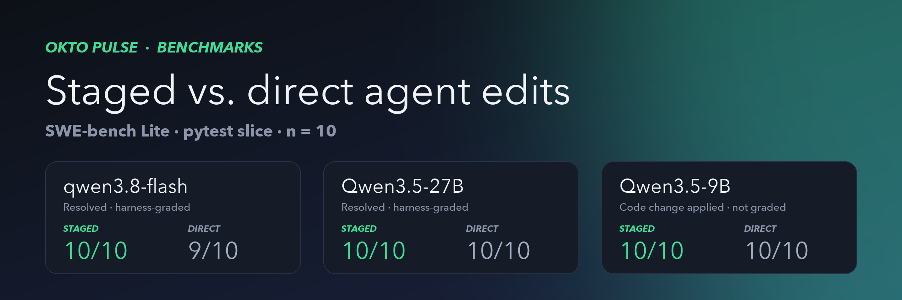

<p align="center">
  
</p>

<p align="center">
  
  
  
</p>

# Pulse Benchmark

**Does [Okto Pulse](https://github.com/OktoLabsAI)'s staged, plan-then-edit workflow produce better patches than a single-shot direct edit?**

This repository answers that with paired runs on [SWE-bench Lite](https://huggingface.co/datasets/SWE-bench/SWE-bench_Lite). Each task is run through a *direct* baseline and a *staged* (Okto Pulse) arm, then graded by the official [`swebench`](https://github.com/SWE-bench/SWE-bench) harness (`FAIL_TO_PASS` / `PASS_TO_PASS`). No LLM judges any result.

## Contents

- [Results at a glance](#results-at-a-glance)
- [Caveats](#caveats)
- [Per-instance breakdown](#per-instance-breakdown)
- [Quick start](#quick-start)
- [Repository layout](#repository-layout)
- [Roadmap](#roadmap)
- [Contributing](#contributing) · [License](#license)

## Results at a glance

All runs use the same 10 `pytest-dev/pytest` instances from SWE-bench Lite.

| Agent model | Metric | Staged (Okto Pulse) | Direct | Report |
|:--|:--|:--:|:--:|:--|
| `qwen3.8-flash` | Resolved (harness-graded) | **10 / 10** | 9 / 10 | [report](docs/reports/2026-09-18-swe-bench-lite-pilot.md) |
| `Qwen3.5-27B` | Resolved (harness-graded) | 10 / 10 | 10 / 10 | [report](docs/reports/2026-10-05-qwen3.5-27b-pytest-pilot.md) |
| `Qwen3.5-9B` | Code change applied (**not** harness-graded) | 10 / 10 | 10 / 10 | [report](docs/reports/2026-09-23-qwen3.5-9b-pytest-pilot.md) |

**Takeaway: promising, not proven.** Staged never did worse than direct on any model.

### qwen3.8-flash: resolved rate, harness-graded

| Arm | Resolved |
|:--|:--:|
| **Staged (Okto Pulse)** | **10 / 10** |
| Direct (single-shot) | 9 / 10 |
| **Staged advantage** | +1 |

Staged resolved the one task direct missed, `pytest-6116`. Per-instance detail is [below](#per-instance-breakdown).

### Qwen3.5-27B: resolved rate, harness-graded

| Arm | Resolved |
|:--|:--:|
| **Staged (Okto Pulse)** | **10 / 10** |
| Direct (single-shot) | 10 / 10 |

Both arms resolved all 10 instances with no regressions (100% of `FAIL_TO_PASS` and `PASS_TO_PASS`). With no discordant pair, this shows staged did not cost anything, not that it helped. Raw evidence: [`results/qwen3.5-27b/harness-reports-raw.txt`](results/qwen3.5-27b/harness-reports-raw.txt). See the [manually verified gate caveat](#caveats).

### Qwen3.5-9B: code-change completion, not harness-graded

| Arm | Code changes applied | Staged lifecycle completed |
|:--|:--:|:--:|
| **Staged (Okto Pulse)** | **10 / 10** | Spec + Task: 10 / 10 |
| Direct (single-shot) | 10 / 10 | n/a |

Both arms produced a code change for all 10 tasks. These patches were not run through the `FAIL_TO_PASS` / `PASS_TO_PASS` harness, so this is implementation coverage rather than a resolved rate and is not blended into the figures above. Evidence: [board export](results/qwen3.5-9b/pulse-board-export.json) and [10 staged diffs](results/qwen3.5-9b/diffs-staged/).

## Caveats

Read these before quoting any number.

- **Small sample, one repo.** 10 tasks from `pytest-dev/pytest`, not the 300-task Lite set. Nothing here is a Lite-wide figure.
- **No significance claim.** A single discordant pair does not clear an exact McNemar test at n=10, so no p-value is reported. Treat the +1 as directional.
- **Harness validated.** Applying the upstream gold patches through the same harness resolves 10/10 ([`results/gold.validate-gold-all-10.json`](results/gold.validate-gold-all-10.json)), so harness or container problems are not behind any observed failure.
- **Staged lifecycle is partial.** Every staged task stopped at spec-approved plus card-created. Pulse's own task-validation gate was not reached.
- **One retry.** One staged task (`task-4`) needed a re-run before it resolved.
- **Manually verified gate (Qwen3.5-27B).** Pulse's `ideation -> done` transition returned a server `500` on ideations with an attached architecture design. For that run the architecture and mockup resources were verified manually, while the remaining gates ran unmodified. Per-instance diffs were not preserved, only the raw harness reports.

## Per-instance breakdown

`qwen3.8-flash`, all 10 instances. `F2P` is passing/total `FAIL_TO_PASS` tests. Every instance in both arms kept 100% of `PASS_TO_PASS`. A check mark means the harness marked the instance `resolved`.

| Instance | Issue | Direct | Staged | F2P (direct) | F2P (staged) | Patch size (direct → staged) |
|---|---|:--:|:--:|:--:|:--:|:--|
| pytest-5221 | Display fixture scope with `pytest --fixtures` | ✅ | ✅ | 2/2 | 2/2 | 1 file / 28 lines → 1 file / 28 lines |
| pytest-5227 | Improve default logging format | ✅ | ✅ | 3/3 | 3/3 | 2 files / 25 lines → 2 files / 25 lines |
| pytest-5413 | `str()` on the `pytest.raises` context variable doesn't match a normal `except` | ✅ | ✅ | 1/1 | 1/1 | 1 file / 18 lines → 1 file / 18 lines |
| pytest-5495 | Confusing assertion-rewrite message for byte strings | ✅ | ✅ | 2/2 | 2/2 | 2 files / 68 lines → 2 files / 68 lines |
| pytest-5692 | Hostname and timestamp in generated JUnit XML | ✅ | ✅ | 2/2 | 2/2 | 2 files / 32 lines → 2 files / 32 lines |
| **pytest-6116** | `--collect-only` needs a one-char shortcut | ❌ | ✅ | **0/2** | **2/2** | 1 file / 18 lines → **2 files / 19 lines** |
| pytest-7220 | Wrong path to test file when a fixture changes directory | ✅ | ✅ | 1/1 | 1/1 | 2 files / 37 lines → 2 files / 37 lines |
| pytest-7373 | Incorrect caching of skipif/xfail string condition evaluation | ✅ | ✅ | 1/1 | 1/1 | 2 files / 65 lines → 2 files / 64 lines |
| pytest-7432 | `--runxfail` breaks skip-location reporting | ✅ | ✅ | 1/1 | 1/1 | 2 files / 21 lines → 2 files / 21 lines |
| pytest-8365 | `tmpdir` creation fails for usernames with illegal directory characters | ✅ | ✅ | 1/1 | 1/1 | 2 files / 25 lines → 2 files / 25 lines |

On the 9 instances both arms resolved, the two patches were near-identical. Staging changed the outcome only where direct's approach was wrong.

<details>
<summary><b>Worked example: why staging fixed pytest-6116</b></summary>

The issue asks for `--co` as a shortcut for `--collect-only`. Both runs found the right area and diverged on how to wire it in.

**Direct** rewrote `-co` to `--collect-only` in the raw argument list before option parsing. That never registers `--co` as a real option, and it targets `-co` rather than the requested `--co`. Both `FAIL_TO_PASS` tests failed.

```diff
--- a/src/_pytest/config/__init__.py
+++ b/src/_pytest/config/__init__.py
+    args = ["--collect-only" if arg == "-co" else arg for arg in args]
     config = get_config(args, plugins)
```

**Staged** registered `--co` as a real alias next to the existing `--collect-only` option, plus a changelog entry per the project's conventions. Both tests passed.

```diff
--- a/src/_pytest/main.py
+++ b/src/_pytest/main.py
         "--collect-only",
+        "--co",
         action="store_true",
```

Full diffs: [direct](results/examples/pytest-6116-direct.diff), [staged](results/examples/pytest-6116-staged.diff).

</details>

## Quick start

```bash
git clone https://github.com/Infrasity-Labs/pulse-benchmark.git
cd pulse-benchmark
pip install -r requirements.txt   # installs swebench; Docker must be running
```

Re-grade the committed predictions with the official harness:

```bash
python -m swebench.harness.run_evaluation \
  --dataset_name SWE-bench/SWE-bench_Lite \
  --predictions_path results/predictions_staged.jsonl \
  --run_id staged --max_workers 4
```

To run the staged arm yourself, you need a running Okto Pulse server and these environment variables:

| Variable | Purpose |
|:--|:--|
| `PULSE_API_KEY` | API key for the benchmark agent (required) |
| `PULSE_BOARD_ID` | Board the staged chain runs on (required) |
| `PULSE_BASE_URL` | REST root, default `http://127.0.0.1:8100/api/v1` |
| `BENCH_WORKSPACE` | Directory holding the pytest checkout and per-task worktrees, default `~/bench-workspace` |

The full end-to-end procedure is in [docs/reproducing.md](docs/reproducing.md).

## Repository layout

```text
.
├── assets/       banner image (assets/banner.png)
├── docs/
│   ├── reproducing.md   end-to-end run guide
│   └── reports/         dated write-ups with full numbers and caveats
├── results/      harness summaries, predictions, gold-patch check, example diffs,
│                 and per-model artifacts (qwen3.5-9b/, qwen3.5-27b/)
├── runners/      staged lifecycle driver, Pulse REST helper, diff emission
├── scripts/      task-definition generator and banner renderer
└── suites/       benchmark definitions (swe_bench_lite/)
```

## Roadmap

1. **Scale up.** More Lite instances, then the other 11 repos, so there is a number worth quoting.
2. **Significance testing.** Paired bootstrap CI or exact McNemar once the sample supports it.
3. **Fix the `ideation -> done` 500** on ideations with an architecture design, then re-run the Qwen3.5-27B staged arm fully server-gated.
4. **Preserve per-instance diffs** for the Qwen3.5-27B run.
5. **More agent models**, ideally ones likely to produce discordant pairs rather than clean sweeps.

## Contributing

Issues and pull requests are welcome. See [CONTRIBUTING.md](CONTRIBUTING.md).

## License

N/A. No license is granted for this repository. Okto Pulse itself is distributed under the [Elastic License 2.0](https://github.com/OktoLabsAI/okto-pulse/blob/main/LICENSE). SWE-bench and its Lite subset are separate projects with their own licenses.
